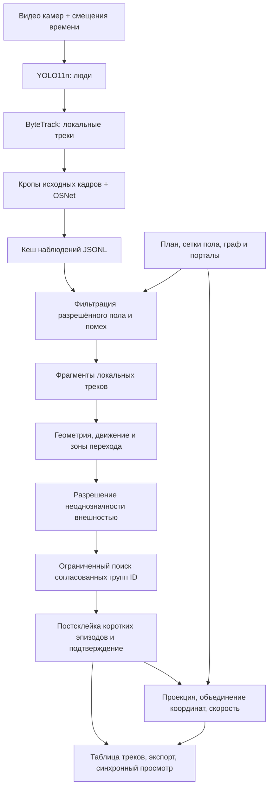

# CV Office — технический обзор решения

Локальный прототип многокамерного сопровождения людей в офисе (MTMC, multi-target multi-camera tracking). На входе — видеозаписи неподвижных камер, план помещения и ручная привязка пола. На выходе — сквозные ID, список треков, синхронный просмотр с рамками и траектории на плане.

Система работает офлайн: видео можно обработать заранее, а затем менять параметры сопоставления без повторного запуска нейросетей. Основной режим — **геометрия и движение; внешность разрешает неоднозначность**. Лица и мелкие предметы не используются. Считаются эпизоды движения со сквозным ID, а не уникальные личности за всё время.

## Быстрый запуск

Проверенная среда: **macOS arm64, Python 3.13, CPU**. MPS и CUDA предусмотрены, но требуют отдельной проверки на целевой машине.

На настроенном MacBook дважды открыть `office_editor.command` либо выполнить из корня репозитория:

```sh
.venv/bin/python -m src.app --open
```

Приложение доступно по адресу <http://127.0.0.1:8765>. Окно терминала оставить открытым, остановка — `Ctrl+C`. Другой порт: `--port 8766`.

На новом компьютере установить Python 3.13 и запустить `setup.command`. Ручной эквивалент:

```sh
python3.13 -m venv .venv
.venv/bin/python -m pip install -r src/vision/requirements-lock.txt
.venv/bin/python -m src.vision prepare
.venv/bin/python -m src.app --open
```

Интернет нужен для установки зависимостей и первоначальной загрузки весов. Сервер слушает `127.0.0.1`; обработка видео и хранение результатов локальные. База данных, внешняя API-служба и веб-фреймворк для запуска не нужны.

## Как получить текущий полный результат

1. Открыть редактор: нарисовать прямые границы помещения, добавить план и неподвижные камеры.
2. Выбрать видео из `data/raw/` или загрузить через интерфейс. Сопоставить файлы с камерами.
3. Установить временные смещения: общий момент события должен иметь одинаковое время во всех камерах. Для последовательных записей одного телефона есть режим «Ролики идут подряд» с паузой.
4. Задать общие зоны обзора (`overlap_with`) и направленные переходы (`transition_to`). Нарисованный сектор камеры сам по себе не доказывает связь.
5. Привязать точки пола на кадре к соответствующим точкам плана. Для сетки разметить углы и промежуточные ориентиры по рабочей области; проверить качество на дополнительных независимых точках.
6. Указать разрешённый пол и при необходимости исключения: зеркала, телевизоры и нерабочие части ракурса.
7. Во вкладке «Просмотр и запуск» нажать **«Обработать видео»**. Это создаст детекции, локальные треки, признаки и первичный результат.
8. Выбрать готовый запуск, профиль **«Переходы по траекториям + зоны пола»** (`trajectory-handoffs`) и нажать **«Проверить фрагменты»**. Именно этот профиль включает вместе фильтр сцены, пересборку ID, траекторные переходы, порталы, подтверждение кандидатов и постсклейку коротких эпизодов.
9. Проверить рамки, таблицу треков и путь выбранного ID. Для диагностики доступны «Показать кандидатов» и «Показать отфильтрованные».

**Первичная обработка видео и профиль эксперимента — отдельные действия.** Само наличие порталов в JSON не включает все дополнительные механизмы в обычном первичном проходе. После изменения геометрии или порогов используйте пересборку фрагментов; обновление только проекции сохраняет ID.

Сейчас для отладки обрабатываются первые **180 секунд каждой записи**. Перед итоговым полным прогоном выставить лимит длительности `0`. Ограничение применяется к каждой камере до добавления временного смещения, поэтому общая шкала просмотра может быть длиннее 180 секунд.

## Архитектура



Редактор, запуск задач и просмотр находятся в `src/app/`. Каждая обработка выполняется в отдельном дочернем процессе и сохраняет снимок проекта. Результаты предыдущих запусков не изменяются при настройке текущего редактора. Пересборка читает кеш наблюдений и создаёт новый запуск с собственным журналом и диагностикой.

### Модели и готовые компоненты

| Компонент | Назначение | Использование |
|---|---|---|
| YOLO11n, Ultralytics | Обнаружение людей | Класс `person`, вход детектора по умолчанию `imgsz=640`, настраиваемые confidence и шаг кадров |
| ByteTrack | Сопровождение внутри одного ракурса | Независимое состояние для каждой камеры; локальный ID ещё не является глобальным |
| OSNet x0.25, веса MSMT17 | Признаки внешности человека | Кроп исходного кадра, вход 256×128, вектор 512 компонент, L2-нормализация |
| PyTorch | Выполнение моделей | CPU по умолчанию, выбор устройства в интерфейсе |
| OpenCV и NumPy | Видео и геометрия | Декодирование, преобразования, полигоны, оценка движения и экспорт кадров |

Признаки извлекаются из подходящих кропов с интервалом по умолчанию 0,5 с. Учитываются размер, резкость и перекрытие; поддерживается ограниченная галерея качественных образцов. Сравниваются только совместимые признаки одной модели и размерности.

Есть экспериментальное высветление тёмных кропов перед OSNet: CLI `--appearance-preprocess gamma`, по умолчанию **выключено**, в обычном запуске через приложение автоматически не включается. Это изменение признаков внешности, а не улучшение исходного разрешения или переобучение детектора. При смене такого препроцессинга признаки нужно извлечь заново.

Собственная часть команды: подготовка и синхронизация записей, управление конвейером, выбор кропов, привязка и сетки, граф камер, правила склейки и конфликтов, порталы, фильтры, экспорт и интерфейс. Детектор, локальный трекер и архитектура ReID взяты готовыми.

### Привязка пола и координаты

- **Гомография:** четыре невырожденные пары «точка кадра → точка плана».
- **Сетка пола:** 4–128 соответствий, триангуляция и кусочно-аффинное преобразование внутри измеренной области. Позволяет локально учитывать перспективу и искривление изображения; не является полной физической калибровкой объектива.
- Проецируется **середина нижней стороны рамки** как приближение положения ног. Обрезанная рамка или перекрытие ухудшают эту оценку.
- Высота камеры, yaw и сектор помогают настроить схему, но не заменяют измеренную привязку пола.
- Нулевая ошибка на обучающих вершинах сетки не доказывает точность между ними. Для этого есть независимые контрольные точки.
- Масштаб `metric_scale` переводит расстояния плана в метры без изменения ручных точек. В сохранённом офисе он приблизительно равен 4,211 м/ед. с заданным допуском 15%.
- Оценки нескольких камер для одного ID объединяются с весами confidence², если не противоречат друг другу. При сильном расхождении сохраняются отдельные точки вместо общей позиции.
- Скорость оценивается по временному окну и учитывает масштаб; не вычисляется как достоверная скорость через длинный пропуск или смену состава наблюдающих камер. Калмановский прогноз используется как вспомогательное свидетельство, а не как фактическое наблюдение.

### Принятие решения об ID

1. **Допуск в сцену.** Нижний центр рамки должен находиться внутри сетки пола или разрешённого полигона и вне исключений. Есть короткий допуск у границы для уже наблюдаемого трека. Неподвижные короткие артефакты могут быть подавлены; исходные детекции остаются в диагностике.
2. **Фрагменты.** Локальные треки становятся единицами офлайн-сопоставления. При устойчивом противоречии возможно их виртуальное разделение.
3. **Кандидаты по графу и времени.** Учитываются общая область обзора, разрешённое направление перехода и время отсутствия. Два конфликтующих локальных трека одной камеры нельзя безусловно объединить.
4. **Геометрия.** Сравниваются положения и движение, границы фрагментов, доступные маршруты и прогноз. Достоверное физическое противоречие мешает склейке. Возможность дойти за минуту сама по себе не доказывает идентичность.
5. **Переходы.** Короткие окна траектории по обе стороны границы дают более устойчивую оценку, чем одна рамка. Для небольших групп конкурирующих переходов используется совместное назначение с возможностью отказаться от связи.
6. **Неоднозначность.** В режиме `geometry_ambiguity` близкие геометрические кандидаты уточняются по внешности. Сходство одежды не должно произвольно преодолевать конфликт одновременных наблюдений.
7. **Группировка.** Ограниченный поиск проверяет совместимость всей группы фрагментов, а не только лучшую пару. Глобальная оптимальность не заявляется.
8. **Постсклейка.** Эпизоды длиной до 3 с проверяются на присоединение к фиксированным опорным трекам с покрытием наблюдениями не менее 8 с. Проверяются прямые свидетельства и конфликты; рекурсивного наращивания опор короткими фрагментами нет.
9. **Подтверждение.** По умолчанию нужны 3 согласованных момента за 0,4–1 с. Две камеры одного момента не дают два независимых подтверждения. Неподтверждённые кандидаты учитываются отдельно; среди них могут быть реальные краткие появления.

Совместимость, надёжность и итоговый score — **эвристические оценки, не откалиброванные вероятности**. Разные режимы `baseline`, `balanced`, `geometry`, `geometry_visual` и `geometry_ambiguity` имеют разные правила; текущий полный профиль использует последний.

### Порталы между камерами

Портал — пара нормированных полигонов **выхода и входа** с ожидаемыми направлениями движения, допустимым временем и надёжностью. Все условия должны выполняться с обеих сторон. Так можно сохранить ID там, где привязки пола разных ракурсов расходятся и дают ложную невозможную скорость.

В текущем офисе настроены **12 направленных порталов для 6 пар**: 1↔2, 1↔3, 2↔3, 3↔4, 3↔5, 4↔5. Для новых зон требуется не менее 0,6 с движения с каждой стороны; прежние 4–5 сохраняют допуск 0,4 с. Продолжительный одновременный обзор по-прежнему сопоставляется по геометрии пола и траектории.

Порталы **не исправляют координаты плана**: они дают свидетельство связи ID. Поэтому сохранённый ID может сопровождаться скачком координат при плохой калибровке. Обратные направления и групповые проходы требуют ручной проверки.

В редакторе зоны показаны оранжевым и имеют переключатели. Вершины, направления и временные параметры хранятся в `handoff_portals` и пока редактируются в JSON; кнопки рисования масок пола не редактируют порталы. Подробнее: [настройка всех переходов](docs/all_camera_portals.md), [исправление перехода 4–5](docs/cam45_transfer_fix.md).

### Жизненный цикл и пропуски

Рабочее доверительное окно сохранения ID — **60 секунд включительно**. После более длинного отсутствия создаётся новый эпизод; явное событие выхода может закрыть трек раньше. Конец файла отмечается `end_of_video` и не доказывает физический выход.

Это осознанное приближение постановки «пока человек виден хотя бы одной камерой»: быстрый уход из всех камер и возврат до timeout могут сохранить ID. Пропуски детекции и отсутствие в зоне обзора нельзя всегда различить автоматически. Путь через пропуск не выдаётся за реальное наблюдение. Офлайн-алгоритм использует будущие кадры и может ретроспективно изменить предварительные ID.

## Конфигурация и пресеты

| Файл | Назначение |
|---|---|
| `configs/office.local.json` | Текущий проект редактора, автосохранение; в Git не включён |
| `configs/presets/office-prefinal-20261107.json` | Предфинальная контрольная конфигурация с прежними порталами 4–5 |
| `configs/presets/office-all-transfers-20261107.json` | Текущая конфигурация всех переходов, 5 камер и 53 ручные пары привязки |
| `configs/presets/*.local.json` | Дополнительные локальные резервные копии, игнорируются Git |
| `runs/product/<id>/project.json` | Точный снимок проекта конкретной обработки |

Пресет содержит привязки и ссылки на локальные ресурсы, но не сами видео и изображение плана. При переносе на другую машину нужно заново подключить соответствующие файлы. Координаты привязки должны относиться к тому же разрешению, ориентации, ракурсу и кадрированию.

Чтобы восстановить сохранённый проект, остановить сервер, сделать резервную копию и выполнить:

```sh
cp configs/office.local.json configs/presets/before-restore.local.json
cp configs/presets/office-all-transfers-20261107.json configs/office.local.json
.venv/bin/python -m src.app --open
```

Первая команда нужна только при наличии текущего проекта. Не заменяйте файл из-под работающего редактора: его автосохранение может записать прежнее состояние поверх копии.

Основные текущие настройки пресета: CPU, `frame_stride=5`, `confidence=0.1`, `max_duration_s=180`, `local_buffer_s=5`, `timeout_s=60`, `tracklet_threshold=0.62`. Это настройки конкретного офиса, а не универсальные пороги качества. Шаг кадров влияет на нейросетевую обработку; `preview_fps` — только на предпросмотр.

## Данные и структура исходного кода

| Путь | Содержимое |
|---|---|
| `src/vision/` | Детектор, локальный трекер, кропы и признаки, подготовка моделей, отладка одного видео |
| `src/association/` | Граф камер, геометрическая политика, фрагменты, ID, порталы и постобработка |
| `src/app/` | HTTP-сервер, редактор, задачи, экспорт и браузерный просмотр |
| `src/floor_mesh.py` | Калибровка и проекция по сетке пола |
| `src/metric_scale.py` | Масштаб и оконная оценка скорости |
| `scripts/` | Служебные сравнения и эксперименты |
| `docs/`, `prompts/` | Постановка, контракты, описания механизмов и задачи команды |
| `data/raw/`, `runs/app/uploads/` | Локальные исходные и загруженные записи |
| `models/` | Загруженные веса и происхождение/контрольные суммы |

Каждый `runs/product/<id>/` содержит:

- `job.json`, `project.json`, `cameras.json`, `status.json`, `worker.log` — воспроизводимые настройки и состояние;
- `vision/observations.jsonl`, `vision/tracklets.json`, `vision/run.json` — детекции, локальные треки, признаки и параметры нейросетевого прохода;
- `association/assignments.jsonl`, `association/tracks.json` — назначения глобальных ID и эпизоды;
- `association/fragment_graph.json`, `association/reconciliation.json` — граф, score, выбранные/отвергнутые связи и диагностика;
- `review.json`, `frames/` — дискретный браузерный предпросмотр без звука;
- `tracks.csv`, `positions.csv`, `report.md`, `performance.json` — выгрузки и отчёт.

Состав отдельных файлов зависит от вида запуска: пересборка использует наблюдения исходного запуска, а изменение только проекции не меняет назначения ID. Форматы входов описаны в [контрактах](docs/contracts.md); `timestamp_s` уже относится к общей шкале времени и не должен получать смещение повторно.

## CLI и отладка

Просмотреть локальное сопровождение одного видео:

```sh
.venv/bin/python -m src.vision debug /path/to/video.mov --open
```

Полная межкамерная ассоциация по уже полученным наблюдениям:

```sh
.venv/bin/python -m src.association \
  --cameras runs/product/SOURCE_RUN/cameras.json \
  --observations runs/product/SOURCE_RUN/vision/observations.jsonl \
  --project configs/office.local.json \
  --output-dir runs/association-review \
  --decision-mode geometry_ambiguity --fragment-mode rebuild \
  --confirm-tracks --filter-scene --trajectory-handoffs --stitch-short-tracks \
  --timeout-s 60 --tracklet-threshold 0.62 --ambiguity-margin 0.03
```

Заменить `SOURCE_RUN` на ID готового запуска. CLI формирует результаты ассоциации; браузерный просмотр и экспорт путей удобнее создавать через приложение. Все доступные параметры: `.venv/bin/python -m src.association --help` и `.venv/bin/python -m src.vision --help`.

## Проверка результата и производительности

На одинаковых текущих настройках и тех же детекциях первых трёх минут пяти камер:

| Вариант | Подтверждённые эпизоды | Многокамерные эпизоды | Кандидаты |
|---|---:|---:|---:|
| Прежние порталы 4–5, запуск `20261107-194124-d294b993` | 27 | 12 | 3 |
| Все переходы, запуск `20261107-194325-a3eb03bc` | 24 | 13 | 3 |

Это сравнение **не является оценкой точности**: эталонной разметки нет, а уменьшение числа ID может означать как правильную склейку, так и ошибочное объединение. Новые связи и обратные направления нужно проверить вручную. Аудит изменений: [JSON сравнения](docs/all_camera_portals_validation.json).

Для ручной проверки смотреть не только счётчик: сохранение ID при переходе, отсутствие смешения одновременно видимых людей, повторное появление после перекрытия, завершение после timeout, короткие кандидаты и положение на плане. Порог настраивать на одном фрагменте, проверять на другом; менять по одному фактору и сохранять исходный контрольный запуск.

Время полного прохода зависит от длительности, разрешения, числа камер и устройства. В `performance.json` и `vision/run.json` есть замеры конкретного запуска. Скорость пересборки готовых детекций нельзя сравнивать со скоростью нейросетевой обработки. Для ускорения отладки используются лимит 180 с, шаг кадров, выборочные признаки внешности и повторное использование кеша. Пропуск кадров может ухудшать локальное сопровождение; большее ускорение не гарантирует лучшее итоговое качество.

## Тесты

```sh
.venv/bin/python -m pytest src -q
```

На текущей версии прошли **257 тестов**: контракты, локальные треки, калибровка и сетки, конфликты геометрии, траектории, порталы, фильтрация, постсклейка, сохранность проекта, задачи HTTP-сервера и экспорт. Тестам сервера нужен доступ к локальному сокету. Нейросетевые веса и длинная обработка настоящего видео не нужны для обычного тестового набора; тесты не заменяют ручную оценку на офисных записях.

## Ограничения и дальнейшая проверка

- Прототип рассчитан на неподвижные камеры и размеченный пол. Изменение ракурса или зума требует новой привязки.
- Низкое разрешение, обрезанные ноги, перекрытия, одинаковая одежда и ошибки локального ID могут разрывать или смешивать глобальные треки.
- Ручные порталы привязаны к конкретной сцене. Они уменьшают зависимость от расхождения проекций, но не устраняют его.
- Подавление короткой неподвижной детекции может скрыть реального человека; поэтому исходные данные остаются доступны в диагностике.
- Реального времени, автоматической калибровки по высоте/сектору, точной реконструкции 3D и автоматического распознавания физического выхода из всех камер не заявляется.
- Длинные записи увеличивают расход диска на кадры и памяти на офлайн-граф; перед финалом нужен полный прогон и независимая проверка нескольких групповых переходов.

Подробные описания: [сетка пола](docs/mesh_geometry.md), [Калман и интеграция геометрии](docs/kalman_integration.md), [траекторные переходы](docs/trajectory_handoffs.md), [пограничные кадры](docs/boundary_handoff_fix.md), [фильтр сцены](docs/scene_filter.md), [короткие эпизоды](docs/short_track_stitching.md), [предфинальная точка восстановления](docs/prefinal_checkpoint.md).

Происхождение моделей, контрольные суммы и условия готовых компонентов перечислены в [THIRD_PARTY.md](src/vision/THIRD_PARTY.md) и `src/vision/vendor/LICENSE.osnet`. Собственная лицензия проекта пока не выбрана. Видео, веса и результаты обработки игнорируются Git; сохранённые JSON-пресеты включают только настройки и разметку.
