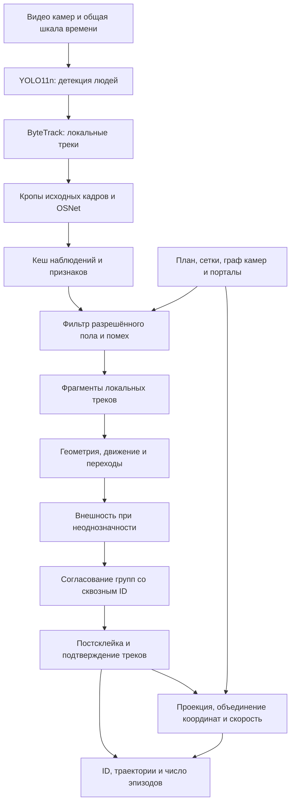

# MTMC — технический обзор решения

Прототип многокамерного сопровождения людей (multi-target multi-camera tracking). Система связывает наблюдения неподвижных камер в сквозные эпизоды с общим ID и строит траектории на плане сцены. Офис служит примером реализации: сетки, граф камер, рабочие области и правила переходов настраиваются под конкретный объект.

Основу сопоставления составляют **геометрия и движение**. Внешность помогает выбрать между неоднозначными кандидатами. Лица и мелкие предметы не используются. Обработка выполняется офлайн и может учитывать будущие наблюдения для уточнения предварительных ID.

## Архитектура



Нейросетевая обработка и межкамерное сопоставление разделены. Кеш содержит исходные наблюдения и признаки, поэтому изменение геометрии и правил склейки не требует повторного запуска моделей. Изменение самого извлечения признаков требует их пересчёта.

## Модели и признаки внешности

| Компонент | Назначение | Технические особенности |
|---|---|---|
| YOLO11n, Ultralytics | Детекция людей | Класс `person`, вход по умолчанию `imgsz=640`, настраиваемые порог уверенности и шаг кадров |
| ByteTrack | Сопровождение внутри камеры | Независимое состояние для каждого ракурса, локальные ID до межкамерного объединения |
| OSNet x0.25, веса MSMT17 | Признаки внешности | Кроп исходного кадра, вход 256×128, вектор размерности 512, L2-нормализация |
| PyTorch | Выполнение моделей | Проверенная реализация на CPU, предусмотрен выбор устройства |
| OpenCV и NumPy | Обработка видео и геометрия | Декодирование, преобразования координат, полигоны, оценка движения |

Признаки извлекаются из подходящих кропов с интервалом по умолчанию 0,5 с. Выбор учитывает размер изображения человека, резкость и перекрытия. Ограниченная галерея качественных образцов уменьшает зависимость от одного неудачного кадра. Косинусное сходство вычисляется только для совместимых признаков одной модели и размерности.

Экспериментальная гамма-коррекция высветляет тёмные кропы перед OSNet. Она по умолчанию выключена и не повышает исходное разрешение изображения. Это дополнительная обработка внешности, а не переобучение детектора.

Смена ракурса, света и ориентации тела может сильно менять признаки одного человека. Поэтому сходство одежды служит вспомогательным свидетельством при геометрической неоднозначности.

## Геометрия сцены

### Сетки соответствий

Настройщик отмечает одни и те же ориентиры на кадре и плане. Система строит триангуляцию и использует **кусочно-аффинное преобразование** внутри измеренной области. Число и плотность опорных точек определяются сложностью сцены, перспективой и необходимой точностью. Текущее число точек в офисной демонстрации не является ограничением концепции.

Для треугольника с вершинами на изображении и соответствующими вершинами на плане положение переводится через барицентрические координаты:

```text
p = λ₁v₁ + λ₂v₂ + λ₃v₃
q = λ₁u₁ + λ₂u₂ + λ₃u₃
λ₁ + λ₂ + λ₃ = 1
```

Здесь `v` — вершины треугольника на кадре, `u` — соответствующие вершины плана, `p` — точка изображения, `q` — её проекция. Внутри треугольника используются одинаковые веса `λ` для обеих систем координат.

Реализация поддерживает 4–128 соответствий на камеру. Сетка позволяет локально учитывать перспективу и искривление изображения. Дополнительно доступна гомография по четырём невырожденным парам. Эти методы не заменяют полную физическую калибровку объектива.

Нулевая ошибка на обучающих вершинах не доказывает точность между ними. Проверку выполняют на независимых контрольных точках и реальных проходах людей. Высота, направление и схематический сектор камеры не заменяют измеренную привязку пола.

### Точка опоры и рабочая область

Проецируется **середина нижней стороны рамки** как приближение положения ног. Для допуска в сцену эта точка должна находиться внутри размеченной сетки или разрешённого полигона и вне исключений.

Рабочую область можно искусственно ограничить, в том числе на дальних участках коридора, где силуэты слишком малы для устойчивого сопровождения. Маски и фильтр коротких неподвижных эпизодов уменьшают влияние отражений, телевизоров и других помех. Для уже наблюдаемого трека предусмотрен короткий допуск у границы. Подавленные наблюдения остаются в диагностике.

### Масштаб, координаты и движение

Масштаб сцены переводит расстояния плана в метры без изменения ручных точек. Скорость оценивается по временному окну с учётом масштаба и его неопределённости. Длинный пропуск или смена состава наблюдающих камер не трактуются как достоверное непрерывное измерение скорости.

Калмановский прогноз и оценки направления движения помогают сопоставлять наблюдения. Прогноз является вспомогательным свидетельством и не выдаётся за фактическое наблюдение человека.

Одновременные оценки одного ID из нескольких камер объединяются с весами confidence², если согласуются между собой. При сильном расхождении система сохраняет отдельные точки вместо общей позиции. Сглаживание не соединяет длинные пропуски.

## Граф камер и порталы

Граф задаёт общие области обзора и направленные переходы. Временные ограничения и топология сокращают множество кандидатов и мешают объединению похожих людей, находящихся в несовместимых местах.

При общем обзоре сравниваются положения и движение в согласованном временном окне. На границе перехода используются короткие участки траектории с обеих сторон, что устойчивее сравнения одиночных рамок.

**Портал** связывает полигон выхода на одной камере с полигоном входа на другой. Связь учитывает:

- попадание в обе зоны;
- согласованное направление движения;
- допустимое время перехода;
- достаточную длительность наблюдаемого движения.

Параметры задаются отдельно для направлений и зависят от сцены. Для небольших групп конкурирующих переходов используется совместное назначение с возможностью отказаться от связи.

Порталы помогают сохранить ID при расхождении калибровок, когда проекция создаёт ложный скачок расстояния и скорости. Они дают свидетельство связи треков, но не исправляют сами координаты на плане. Продолжительный одновременный обзор сохраняет сопоставление по геометрии пола и траектории.

## Принятие решения об ID

1. **Формирование фрагментов.** Локальные треки становятся единицами офлайн-сопоставления. При устойчивом противоречии возможно их виртуальное разделение.
2. **Отбор кандидатов.** Проверяются время, граф камер, общая зона обзора и разрешённое направление перехода.
3. **Геометрическое свидетельство.** Сравниваются положения, движение, границы фрагментов, доступные маршруты и прогноз. Возможность дойти за заданное время сама по себе не доказывает идентичность.
4. **Разрешение неоднозначности.** В режиме `geometry_ambiguity` близкие геометрические кандидаты уточняются по внешности. Другие реализованные режимы используют отдельные политики сопоставления.
5. **Согласование групп.** Ограниченный поиск проверяет совместимость всей группы фрагментов. Достоверный физический конфликт или несовместимое одновременное наблюдение препятствуют объединению. Глобальная оптимальность поиска не заявляется.
6. **Постсклейка.** Эпизоды длиной до 3 с проверяются на присоединение к фиксированным опорным трекам с покрытием наблюдениями не менее 8 с. Нужны прямые свидетельства и отсутствие конфликтов. Рекурсивного наращивания опор короткими фрагментами нет.
7. **Подтверждение.** По умолчанию нужны 3 согласованных момента за 0,4–1 с. Две камеры одного момента не считаются двумя независимыми подтверждениями. Кандидаты, не получившие подтверждения, учитываются отдельно.

Совместимость, надёжность и итоговый score являются эвристическими оценками, а не откалиброванными вероятностями. Численная оценка внешности не должна произвольно преодолевать достоверное геометрическое противоречие.

## Жизненный цикл трека

Рабочее доверительное окно сохранения ID составляет **60 секунд включительно**. После более длинного отсутствия начинается новый эпизод. Явное событие выхода может закрыть трек раньше. Конец файла отмечается `end_of_video` и не доказывает физический выход человека.

Такое окно позволяет переживать пропуски детекции и временные перекрытия. При быстром уходе из всех камер и возврате до timeout система может сохранить ID: пропуск детекции и физическое отсутствие не всегда различимы автоматически. Счётчик отражает эпизоды сопровождения, а не уникальные личности за всё время.

## Результат на тестовом фрагменте

На тестовом **трёхминутном фрагменте** офисной сцены количество подтверждённых сквозных треков в ручных прогонах варьируется в диапазоне **24–26**. Результат зависит в том числе от ручной настройки сетки: положения опорных точек и согласования проекций между камерами. Это влияет на расстояния, направления и решения о межкамерной склейке.

Для получения лучшего результата на конкретном объекте необходимы корректная настройка оборудования, точная разметка пола и проверка переходов на месте установки камер. Сетка должна соответствовать реальным ракурсам и масштабу сцены, а её точность нужно подтверждать независимыми точками и проверочными проходами.

Диапазон 24–26 описывает число полученных эпизодов, а не процент точности. Оценка качества требует проверки сохранения ID и отсутствия ошибочных объединений по ручному эталону. Офисные данные демонстрируют работу метода на одном сценарии.

## Ограничения

- Метод предполагает неподвижные камеры и размеченную поверхность движения. Изменение ракурса, зума, разрешения или кадрирования требует проверки привязки.
- Низкое разрешение, обрезанные ноги, перекрытия и ошибки локального трекера могут приводить к разрывам или смешению глобальных ID.
- Сетки и порталы требуют настройки под объект. Порталы уменьшают зависимость склейки от расхождения проекций, но не устраняют это расхождение.
- Фильтр коротких неподвижных эпизодов может подавить реальное краткое появление, поэтому исходные наблюдения сохраняются.
- Прототип работает офлайн. Работа в реальном времени, автоматическая полная калибровка и точная реконструкция 3D не заявляются.

## Реализация и технические материалы

| Модуль | Ответственность |
|---|---|
| `src/vision/` | Детекция, локальные треки и извлечение признаков |
| `src/association/` | Граф, политики сопоставления, фрагменты, порталы и постобработка |
| `src/floor_mesh.py` | Сетки и преобразование координат |
| `src/metric_scale.py` | Масштаб и оконная оценка скорости |
| `src/app/` | Редактор сцены, конвейер задач, координатное объединение и просмотр |

Команда реализовала подготовку и синхронизацию записей, выбор кропов, геометрическую модель, граф, правила конфликтов, склейку, фильтры и интерфейс. Детектор, локальный трекер и архитектура ReID используются как готовые компоненты.

Подробности: [контракты данных](docs/contracts.md), [сетки пола](docs/mesh_geometry.md), [Калман и геометрия](docs/kalman_integration.md), [траекторные переходы](docs/trajectory_handoffs.md), [порталы](docs/all_camera_portals.md), [фильтр сцены](docs/scene_filter.md), [постсклейка](docs/short_track_stitching.md). Источники и условия использования готовых компонентов перечислены в [THIRD_PARTY.md](src/vision/THIRD_PARTY.md).
